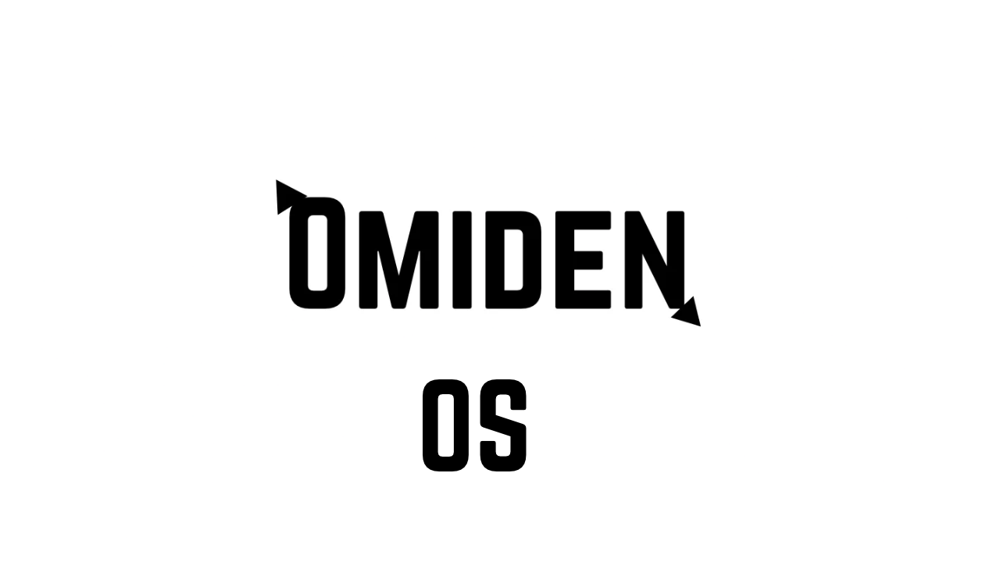

<div align="center">



# OmidenOS

**Arch Linux + BlackArch tabanlı güvenlik odaklı Linux dağıtımı**

[](https://github.com/muhemmed0634/OmidenOS/stargazers)
[](https://github.com/muhemmed0634/OmidenOS/network)
[](LICENSE)
[](https://archlinux.org)
[](https://blackarch.org)
[](https://github.com/muhemmed0634/OmidenOS)

</div>

---

```
  ██████╗ ███╗   ███╗██╗██████╗ ███████╗███╗   ██╗  ██████╗ ███████╗
 ██╔═══██╗████╗ ████║██║██╔══██╗██╔════╝████╗  ██║ ██╔═══██╗██╔════╝
 ██║   ██║██╔████╔██║██║██║  ██║█████╗  ██╔██╗ ██║ ██║   ██║███████╗
 ██║   ██║██║╚██╔╝██║██║██║  ██║██╔══╝  ██║╚██╗██║ ██║   ██║╚════██║
 ╚██████╔╝██║ ╚═╝ ██║██║██████╔╝███████╗██║ ╚████║ ╚██████╔╝███████║
  ╚═════╝ ╚═╝     ╚═╝╚═╝╚═════╝ ╚══════╝╚═╝  ╚═══╝  ╚═════╝ ╚══════╝
```

> ⚠️ **Pre-Alpha** — Test amaçlıdır. Sanal makinede deneyin.

---

## Hakkında

OmidenOS, [ArchISO](https://wiki.archlinux.org/title/Archiso) kullanılarak sıfırdan inşa edilmiş özel bir Linux dağıtımıdır. Arch Linux rolling-release modelini ve BlackArch'ın 100+ güvenlik aracını bir araya getiren,  güvenlik araştırmaları için tasarlanmıştır.

---

## Özellikler

| | |
|---|---|
| **Base** | Arch Linux (rolling release) |
| **Güvenlik** | BlackArch repo + 324 paket + 112 araç (install-tools) |
| **Masaüstü** | Openbox + Tint2 + Rofi |
| **Terminal** | Alacritty |
| **Shell** | Zsh (autosuggestions, syntax-highlighting) |
| **Sistem bilgisi** | Fastfetch (OmidenOS ASCII logo) |
| **Tema** | Adw-dark + Papirus-Dark |
| **Wallpaper** | OmidenOS logosu (değiştirilebilir — waypaper) |
| **Klavye** | US (English) |
| **Ses** | PipeWire |
| **Ağ** | NetworkManager + iwd |
| **Boot** | BIOS (syslinux) + UEFI (systemd-boot) |
| **Boot splash** | OmidenOS logosu |

---

## Güvenlik Araçları

<details>
<summary><b>🔍 Reconnaissance (ISO'da hazır)</b></summary>

`nmap` · `masscan` · `amass` · `subfinder` · `httpx` · `dnsx` · `ffuf` · `gobuster` · `feroxbuster` · `nikto` · `nuclei` · `whatweb` · `wafw00f` · `wpscan` · `theharvester` · `recon-ng` · `spiderfoot` · `dnsrecon` · `fierce`

</details>

<details>
<summary><b>🌐 Web Application Testing (ISO'da hazır)</b></summary>

`sqlmap` · `zaproxy` · `xsstrike` · `dalfox` · `commix` · `wfuzz` · `arjun` · `jwt-tool` · `ssrfmap` · `ghauri` · `corsy` · `smuggler`

</details>

<details>
<summary><b>🔗 Network & Traffic (ISO'da hazır)</b></summary>

`wireshark` · `bettercap` · `ettercap` · `responder` · `mitmproxy` · `tcpdump` · `scapy` · `hping` · `yersinia` · `sslstrip` · `macchanger` · `mitm6`

</details>

<details>
<summary><b>🔑 Password Attacks (ISO'da hazır)</b></summary>

`hashcat` · `john` · `hydra` · `medusa` · `kerbrute` · `mimikatz` · `python-pypykatz` · `certipy` · `evil-winrm` · `crowbar`

</details>

<details>
<summary><b>💥 Exploitation (ISO'da hazır)</b></summary>

`metasploit` · `exploitdb` · `routersploit` · `beef` · `empire` · `sliver`

</details>

<details>
<summary><b>🕵️ Post Exploitation (ISO'da hazır)</b></summary>

`bloodhound` · `crackmapexec` · `smbmap` · `enum4linux` · `ldeep`

</details>

<details>
<summary><b>🔬 Reverse Engineering (ISO'da hazır)</b></summary>

`radare2` · `cutter` · `pwndbg` · `binwalk` · `angr` · `python-pwntools` · `checksec` · `yara`

</details>

<details>
<summary><b>🧪 Forensics (ISO'da hazır)</b></summary>

`volatility3` · `sleuthkit` · `bulk-extractor` · `dc3dd` · `dcfldd` · `perl-image-exiftool` · `stegseek` · `zsteg` · `python-oletools`

</details>

<details>
<summary><b>📡 Wireless (ISO'da hazır)</b></summary>

`aircrack-ng` · `airgeddon` · `wifite` · `kismet` · `reaver` · `pixiewps` · `bully` · `wifi-pumpkin`

</details>

<details>
<summary><b>🔧 install-tools ile kurulabilen +112 araç</b></summary>

**Heavy GUI:** `burpsuite` · `ghidra` · `autopsy` · `maltego` · `neo4j-community` · `retdec` · `havoc-c2`

**Web:** `w3af` · `arachni` · `set` · `xsser` · `swaks` · `webanalyze`

**Mobile:** `jadx` · `androguard` · `dex2jar` · `mobsf` · `android-apktool`

**Reverse:** `rizin` · `capstone` · `unicorn` · `keystone` · `z3` · `ropgadget` · `gef`

**Forensics:** `ophcrack` · `stegcracker` · `volafox` · `afflib` · `rifiuti2`

**Network/AD:** `netexec` · `rita` · `smbclient` · `dmitry` · `nbtscan` · `dnsenum`

</details>

---

## Kurulum

### Gereksinimler

- Arch Linux tabanlı bir sistem
- `archiso` paketi
- Root yetkisi
- ~15 GB boş disk alanı
- İnternet bağlantısı

### ISO Oluştur

```bash
git clone https://github.com/muhemmed0634/OmidenOS.git
cd OmidenOS
sudo pacman -S archiso
sudo ./scripts/build.sh
```

### USB'ye Yaz

```bash
# Script ile
sudo ./scripts/flash-usb.sh

# Manuel (sdX = USB sürücün)
sudo dd if=out/omidenos-*.iso of=/dev/sdX bs=4M status=progress oflag=sync
```

### Live Ortamda Çalıştır

- Root olarak **şifresiz** otomatik giriş yapılır
- WiFi: `nmtui`
- Ek araçlar: `install-tools`
- Wallpaper yöneticisi: `install-waypaper`

### Diske Kur

```bash
install-omiden
```

Kurulum sihirbazı:
- UEFI / BIOS otomatik algılar
- Disk seçimi ve bölümlendirme (ext4 / btrfs / xfs)
- Timezone listesi (Azerbaycan dahil)
- Kullanıcı, şifre, hostname
- Openbox masaüstü (isteğe bağlı)
- BlackArch repo (isteğe bağlı)
- GRUB önyükleyici

---

## Komutlar

| Komut | Açıklama |
|-------|---------|
| `install-omiden` | Sistemi diske kur |
| `install-tools` | 112 ek araç kur (kategorili menü) |
| `setup-blackarch` | BlackArch reposunu ekle |
| `install-waypaper` | Wallpaper yöneticisi kur |
| `omiden-welcome` | Hoş geldin ekranı |
| `nmtui` | WiFi/ağ bağlantısı |
| `fastfetch` | Sistem bilgisi |

---

## Proje Yapısı

```
OmidenOS/
├── archiso-profile/
│   ├── profiledef.sh
│   ├── packages.x86_64          # 324 paket
│   ├── pacman.conf              # Arch + BlackArch repo
│   └── airootfs/
│       ├── etc/
│       │   ├── mkinitcpio.conf.d/archiso.conf  # Live initramfs hooks
│       │   ├── shadow           # Root şifresiz giriş
│       │   ├── systemd/system/  # Servis enable'ları
│       │   └── ...
│       ├── root/.config/
│       │   ├── fastfetch/       # ASCII logo + config
│       │   ├── openbox/         # WM config
│       │   ├── alacritty/       # Terminal
│       │   ├── rofi/            # Launcher
│       │   └── ...
│       └── usr/local/bin/
│           ├── install-omiden   # Kurulum sihirbazı
│           ├── install-tools    # 112 araç yükleyici
│           ├── install-waypaper # Wallpaper yöneticisi
│           ├── omiden-welcome   # Hoş geldin
│           └── setup-blackarch  # BlackArch repo
├── scripts/
│   ├── build.sh
│   └── flash-usb.sh
└── Omiden.png
```

---

## Katkı

```bash
git clone https://github.com/muhemmed0634/OmidenOS.git
```

PR ve issue'lar her zaman açıktır.

---

## Lisans

[GPL-3.0](LICENSE) © [muhemmed0634](https://github.com/muhemmed0634)

---

<div align="center">
<i>Arch Linux'un gücü. BlackArch'ın araçları. OmidenOS'un tarzı.</i>
</div>
