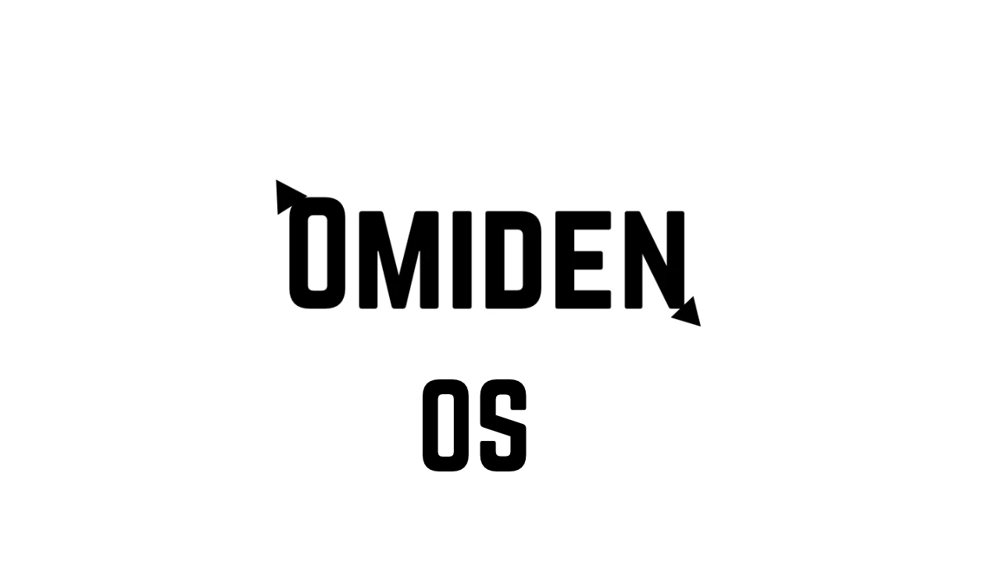

<div align="center">



# Omiden OS

**Cybersecurity-Focused Arch Linux Distribution**

[](LICENSE)
[](https://archlinux.org)
[](https://github.com/muhemmed0634/OmidenOs)

</div>

---

```
 ██████╗ ███╗   ███╗██╗██████╗ ███████╗███╗   ██╗     ██████╗ ███████╗
██╔═══██╗████╗ ████║██║██╔══██╗██╔════╝████╗  ██║    ██╔═══██╗██╔════╝
██║   ██║██╔████╔██║██║██║  ██║█████╗  ██╔██╗ ██║    ██║   ██║███████╗
██║   ██║██║╚██╔╝██║██║██║  ██║██╔══╝  ██║╚██╗██║    ██║   ██║╚════██║
╚██████╔╝██║ ╚═╝ ██║██║██████╔╝███████╗██║ ╚████║    ╚██████╔╝███████║
 ╚═════╝ ╚═╝     ╚═╝╚═╝╚═════╝ ╚══════╝╚═╝  ╚═══╝     ╚═════╝ ╚══════╝
```

> Professional penetration testing and security research distribution built from scratch on Arch Linux

---

## 🎯 About

Omiden OS is a cybersecurity-focused Linux distribution built on Arch Linux, specifically designed for penetration testers, security researchers, and ethical hackers. It comes pre-configured with **100+ professional security tools** and offers a choice between Hyprland (Wayland) and i3 (X11) window managers.

---

## ✨ Key Features

| Feature | Description |
|---------|-------------|
| **🔐 100+ Security Tools** | Professional penetration testing, network analysis, exploitation, and forensics tools |
| **🎨 Dual WM Support** | Choose Hyprland (modern Wayland) or i3 (classic X11) during installation |
| **⚡ Arch-Based** | Rolling release model with latest packages and AUR support |
| **🌍 Bilingual** | Full support for English and Azerbaijani languages |
| **🎭 Pre-Configured** | Beautiful dotfiles with Catppuccin theme, ready to use out of the box |
| **📦 Single Source** | All tools and configurations managed from YAML files |
| **🚀 Performance** | Minimal base system, install only what you need |

---

## 🛠️ Security Tools by Category

<details>
<summary><b>🔍 Network Security & Reconnaissance</b></summary>

- **Scanning:** nmap, masscan, zmap, unicornscan
- **Analysis:** wireshark, tcpdump, ettercap, bettercap
- **Discovery:** netcat, socat, mtr, traceroute
- **OSINT:** theharvester, maltego, recon-ng, sherlock
- **DNS:** fierce, dnsrecon, dnsenum, subfinder

</details>

<details>
<summary><b>🌐 Web Application Testing</b></summary>

- **Proxies:** Burp Suite, OWASP ZAP, mitmproxy
- **Scanners:** Nikto, WPScan, Wapiti, Arachni
- **SQL Injection:** SQLMap, NoSQLMap
- **XSS:** XSSer, Dalfox
- **Fuzzing:** ffuf, gobuster, wfuzz, feroxbuster
- **CMS:** WPScan, Joomscan, Droopescan

</details>

<details>
<summary><b>📡 Wireless Security</b></summary>

- **Frameworks:** Aircrack-ng suite
- **Attacks:** Wifite, Reaver, Bully, Pixiewps
- **Monitoring:** Kismet, Airodump-ng
- **Tools:** Airgeddon, WiFi-Pumpkin3

</details>

<details>
<summary><b>💥 Exploitation & Post-Exploitation</b></summary>

- **Frameworks:** Metasploit Framework, Empire, Sliver
- **Databases:** ExploitDB, RouterSploit
- **Post-Exploit:** BloodHound, CrackMapExec, Evil-WinRM
- **AD Tools:** Impacket, Kerbrute, Responder, Mimikatz

</details>

<details>
<summary><b>🔑 Password Attacks</b></summary>

- **Cracking:** Hashcat, John the Ripper
- **Online:** Hydra, Medusa, Ncrack
- **Tools:** Crunch, CeWL, Maskprocessor
- **Windows:** pypykatz, Certipy

</details>

<details>
<summary><b>🔬 Reverse Engineering & Binary Analysis</b></summary>

- **Disassemblers:** Ghidra, Radare2, Cutter
- **Debuggers:** GDB, pwndbg, gef
- **Analysis:** Binwalk, Angr, pwntools
- **Utils:** checksec, ROPgadget, Ropper

</details>

<details>
<summary><b>🧪 Forensics & Data Recovery</b></summary>

- **Memory:** Volatility3, Rekall
- **Disk:** Autopsy, Sleuthkit, dc3dd
- **Carving:** Foremost, Scalpel, bulk-extractor
- **Steganography:** Steghide, Stegseek, zsteg
- **Metadata:** ExifTool, pdfid, pdf-parser

</details>

<details>
<summary><b>🎭 Social Engineering</b></summary>

- **Frameworks:** Social Engineer Toolkit (SET)
- **Phishing:** GoPhish, King Phisher
- **OSINT:** Maltego, SpiderFoot

</details>

---

## 📥 Download & Installation

### System Requirements

- **RAM:** 2 GB minimum (4 GB recommended)
- **Storage:** 20 GB minimum
- **Boot:** UEFI or BIOS support
- **Network:** Internet connection for installation

### Download ISO

Download the latest release from [GitHub Releases](https://github.com/muhemmed0634/OmidenOs/releases)

```bash
# Verify checksum
sha256sum omidenos-*.iso

# Compare with release notes
```

### Create Bootable USB

**Linux:**
```bash
sudo dd if=omidenos-*.iso of=/dev/sdX bs=4M status=progress oflag=sync
```

**Windows:** Use [Rufus](https://rufus.ie/) or [Balena Etcher](https://www.balena.io/etcher/)

**macOS:**
```bash
sudo dd if=omidenos-*.iso of=/dev/diskX bs=4m
```

**Universal:** Use [Ventoy](https://www.ventoy.net/) for multi-ISO USB

### Installation

1. Boot from USB
2. Run `sudo omiden-installer`
3. Follow the interactive installation wizard:
   - Select disk and partition layout
   - Choose window manager (Hyprland/i3/Both/None)
   - Set hostname, username, and password
   - Configure system settings
4. Reboot and enjoy!

---

## 🎨 Window Managers

### Hyprland (Wayland)

Modern, GPU-accelerated compositor with:
- Smooth animations and blur effects
- Multi-monitor support
- Gesture controls
- Waybar status bar
- Catppuccin theme

### i3 (X11)

Classic, lightweight tiling WM with:
- Proven stability
- Low resource usage
- Polybar status bar
- Extensive customization
- Perfect for older hardware

---

## 🚀 Quick Start

### After Installation

```bash
# Update system
sudo pacman -Syu

# Install additional tools from AUR
yay -S <package-name>

# Configure network
nmtui

# Launch tools
nmap --help
metasploit
burpsuite
wireshark
```

### Keyboard Shortcuts

See full list on the [website](https://muhemmed0634.github.io/OmidenOs) or check:
- Hyprland: `~/.config/hypr/hyprland.conf`
- i3: `~/.config/i3/config`

**Common shortcuts:**
- `Super + Return` - Terminal
- `Super + D` - Application launcher
- `Super + E` - File manager
- `Super + C` - Close window
- `Super + 1-9` - Switch workspace

---

## 📚 Documentation

- [Installation Guide](docs/installation.md)
- [Tool List](data/tools.yml)
- [Keybindings](data/keybinds.yml)
- [Website](https://muhemmed0634.github.io/OmidenOs)

---

## 🛠️ Development

### Build from Source

```bash
# Clone repository
git clone https://github.com/muhemmed0634/OmidenOs.git
cd OmidenOs

# Install dependencies
sudo pacman -S archiso

# Generate package lists
python3 scripts/gen-packages.py

# Build ISO (requires root)
sudo bash scripts/build.sh

# Test in QEMU
bash scripts/test.sh out/omidenos-*.iso
```

### Project Structure

```
OmidenOs/
├── archiso-profile/       # ISO build configuration
├── data/                  # Tool and keybind definitions
├── dotfiles/              # Pre-configured dotfiles
├── scripts/               # Build and generation scripts
├── site/                  # Static website
└── docs/                  # Documentation
```

---

## 🤝 Contributing

Contributions are welcome! Please:

1. Fork the repository
2. Create a feature branch
3. Make your changes
4. Submit a pull request

**Areas for contribution:**
- Adding new security tools
- Improving documentation
- Testing on different hardware
- Translating to other languages
- Creating tutorials and guides

---

## ⚖️ Legal Disclaimer

Omiden OS is designed for **legal security testing and research purposes only**. Users are responsible for complying with all applicable local, state, national, and international laws. The developers assume no liability and are not responsible for any misuse or damage caused by this distribution.

**Use this distribution only on systems you own or have explicit permission to test.**

---

## 📜 License

[BSD 3-Clause License](LICENSE) © [muhemmed0634](https://github.com/muhemmed0634)

---

## 🙏 Credits

- **Base:** [Arch Linux](https://archlinux.org/)
- **Theme:** [Catppuccin](https://github.com/catppuccin)
- **Wallpapers:** [JaKooLit/Wallpaper-Bank](https://github.com/JaKooLit/Wallpaper-Bank)
- **Tools:** Security community contributors

---

<div align="center">

**[Website](https://muhemmed0634.github.io/OmidenOs)** • **[Releases](https://github.com/muhemmed0634/OmidenOs/releases)** • **[Issues](https://github.com/muhemmed0634/OmidenOs/issues)**

<i>Professional cybersecurity distribution built by hackers, for hackers.</i>

</div>
