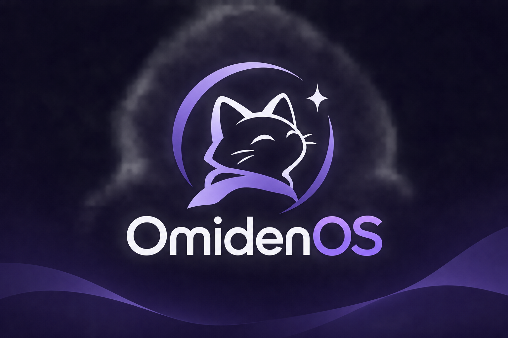
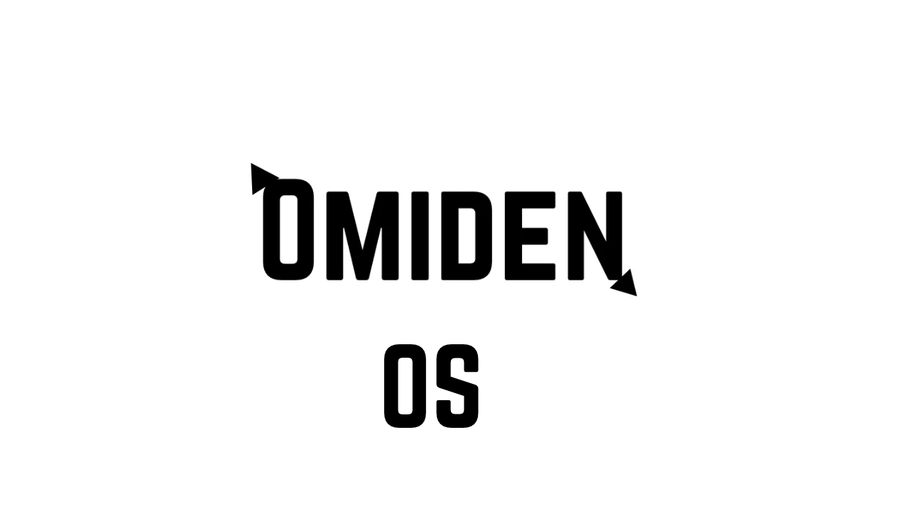

<div align="center">
  
</div>

<p align="center">
  A pacman-based live system for security work, built with <code>mkarchiso</code>.
  <br>
  UEFI 64-bit only &middot; systemd-boot &middot; ext4 &middot; XFCE &middot; Calamares
</p>

<p align="center">
  <a href="https://github.com/muhemmed0634/OmidenOs/actions/workflows/lint.yml"></a>
  
  
  
  
</p>

## What this is

OmidenOS boots from a live medium and runs from a compressed, read-only
squashfs with a writable overlay held in RAM. The v1.0 install path adds
Calamares on top of the same profile. The profile is UEFI-only by
design: there is no BIOS/CSM boot path, no syslinux, no GRUB, and no
32-bit UEFI support anywhere in the tree.

The project is built in phases. Each phase has an exit criterion, and a
phase is only closed when that criterion is backed by a recorded check
rather than by a plausible-looking tree. The roadmap, the decision
records and the open items live in `docs/`.

Status: **Phase 2 in progress.** The live-medium profile exists; the
boot proof for it is still pending. There is no installer, no desktop
and no tool set on the medium yet.

## At a glance

| Aspect | v1.0 target | Today |
| --- | --- | --- |
| Base | pacman-based, rolling | profile in place |
| Build | `mkarchiso` (archiso 92) | profile in place, no build target |
| Boot | UEFI 64-bit only, systemd-boot | entries written, not yet booted |
| Root filesystem | ext4 | fixed scope decision |
| Disk encryption | none, out of v1.0 scope | not applicable |
| Installer | Calamares | not part of the profile yet |
| Desktop | XFCE only | not part of the profile yet |
| Secure Boot | not supported, ISO unsigned | decision recorded |
| Kernel | own `linux-omiden` package | stock kernel for the interim boot |

## Phases

| Phase | Content | State |
| --- | --- | --- |
| 0 | Discovery, tool resolution, decision records | done |
| 1 | Repository skeleton, lint chain, brand scan | done, licensing decision open |
| 2 | UEFI-only live medium | in progress |
| 3 | Own hook set, `[omidenos]` repository, own kernel | planned |
| 4 | Tool manifest, meta packages | planned |
| 5 | Brand pipeline, Plymouth, display manager, XFCE | planned |
| 6 | Calamares configuration, install test matrix | planned |
| 7 | Hardening review, SBOM, release pipeline | planned |

Exit criteria per phase: `docs/dev/phase-0-report.md`. Pending work:
`docs/BACKLOG.md`.

## Repository layout

| Path | Contents |
| --- | --- |
| `archiso/` | live-medium profile: `profiledef.sh`, `packages.x86_64`, `pacman.conf`, `efiboot/`, `airootfs/` |
| `branding/` | brand-scan term configuration, upstream allowlist, logo source |
| `docs/adr/` | architecture decision records, one per open design question |
| `docs/dev/` | phase reports, build instructions, tool resolution |
| `scripts/` | `lint-style`, `brand-scan` (Python 3, standard library only) |
| `tests/` | unit tests for the scanners |
| `Makefile` | `lint`, `brand-scan`, `tests` |

The repository enforces its own style rules: no work-item markers in
tracked files, no emoji, no marketing vocabulary. Open items belong in
`docs/BACKLOG.md`, not in code comments.

## Build the live medium

Requirements: a pacman-based host with `archiso` installed, root access,
and several GiB of free disk space. Full notes in
`docs/dev/building.md`.

```
sudo mkarchiso -v -w build/work -o build/out archiso
```

Output: `build/out/omidenos-<version>-x86_64.iso` plus the sha256 file
written by `mkarchiso`. `build/` is gitignored.

## Boot test

QEMU with OVMF, no Secure Boot, empty NVRAM:

```
qemu-system-x86_64 \
    -machine q35,accel=kvm \
    -m 4G \
    -drive if=pflash,format=raw,readonly=on,file=/usr/share/edk2/x64/OVMF_CODE.4m.fd \
    -drive if=pflash,format=raw,file=/usr/share/edk2/x64/OVMF_VARS.4m.fd \
    -cdrom build/out/omidenos-<version>-x86_64.iso \
    -display none -serial file:build/serial.log
```

BIOS boot is expected to fail: the ISO carries no El Torito BIOS entry
and no MBR boot code. Verify with
`xorriso -indev <iso> -report_el_torito plain`.

The boot menu offers four entries: the standard live session, copy to
RAM, safe graphics (`nomodeset`), and forensic mode.

## Checks

```
make lint        # style checks, brand scan, unit tests, optional linters
make brand-scan  # brand scan in strict mode
make tests       # unit tests only
```

`make lint` runs `shellcheck`, `shfmt`, `ruff`, `mypy` and `reuse` when
they are installed, and reports the ones it had to skip.

## Current limitations

- UEFI 64-bit firmware is required. BIOS/CSM and 32-bit UEFI are not
  supported.
- Secure Boot is not supported; the ISO is not signed.
- The live medium uses the stock kernel and the stock live hooks, so the
  kernel suffix and the live parameters still carry upstream names. The
  own kernel and the renamed hook set are Phase 3 work.
- The forensic-mode menu entry exists, but with the stock hooks the
  parameter behind it is not acted on yet. It stays a placeholder until
  Phase 3 wires it up.
- The live session runs a passwordless sudo user and a root account with
  an empty password. Both are live-medium only and are not carried into
  an installed system.
- Calamares is not part of the profile yet, so there is no install path
  today.

## Decisions and planning

- `docs/adr/` holds the decision records: kernel packaging, live hooks,
  identity files, installer, display manager, bootloader and encryption
  scope, brand scan, licensing.
- `docs/BACKLOG.md` holds everything still open, including the one
  unresolved licensing question.
- The brand scan enforces that no third-party distribution names appear
  on user-visible surfaces. That is why this file talks about a
  pacman-based base system rather than naming the upstream.

## Brand assets

<table>
  <tr>
    <td align="center"></td>
    <td align="center"></td>
  </tr>
  <tr>
    <td align="center">Cat crest with crescent and star, current mark</td>
    <td align="center">Wordmark, earlier mark</td>
  </tr>
</table>

Source assets live in `branding/source/`. The owner supplies a vector
version of the crest; until then the raster file is the reference asset
for derived artwork.

## License

Project code: BSD 3-Clause (`LICENSE`). Brand assets: CC-BY-SA-4.0
(`LICENSES/`, `REUSE.toml`). The license choice is recorded in
`docs/adr/0009-licensing.md` and is the last open item of Phase 1.
